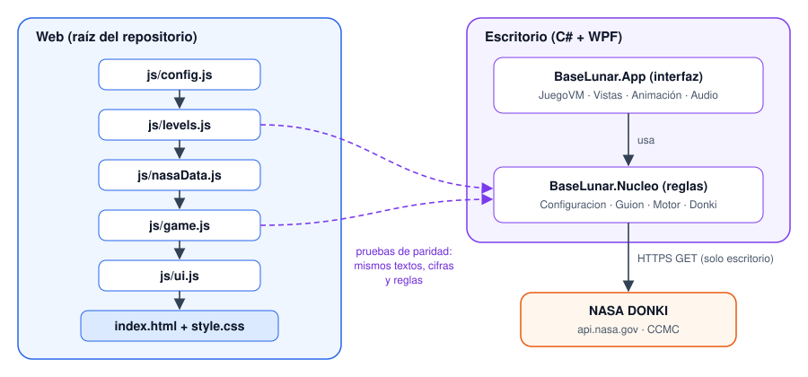
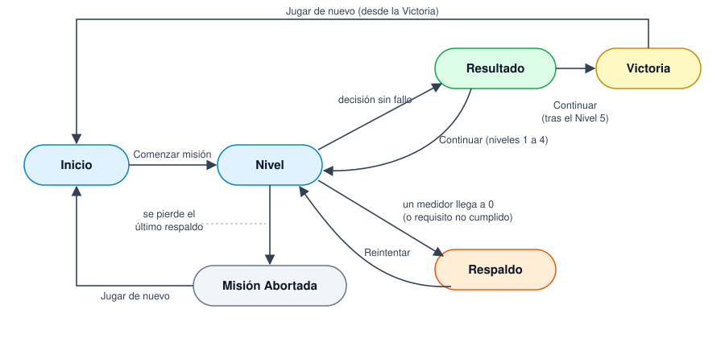
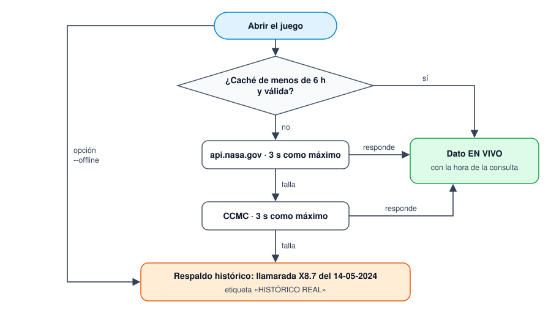

# Documentación técnica · Base Lunar: El Escudo Cósmico

Versión 1.0.0 · 15-11-2026

Este documento explica cómo está hecho el juego, con qué herramientas, cómo se valida, cómo se publica y cómo se mantiene. Está pensado para quien vaya a continuar el proyecto o a evaluarlo. También está en PDF: [DOCUMENTACION.pdf](pdf/DOCUMENTACION.pdf).

- Para jugar: [MANUAL-DE-USUARIO.md](MANUAL-DE-USUARIO.md).
- La especificación original: [PROMPT-0.md](PROMPT-0.md).
- Cada decisión tomada, con su motivo: [../DECISIONES.md](../DECISIONES.md) (D-01 a D-64).

## Índice

1. [Resumen](#1-resumen)
2. [Método de trabajo y fases](#2-método-de-trabajo-y-fases)
3. [Herramientas y tecnologías](#3-herramientas-y-tecnologías)
4. [Arquitectura general](#4-arquitectura-general)
5. [El núcleo: reglas, motor y contenido](#5-el-núcleo-reglas-motor-y-contenido)
6. [La versión web](#6-la-versión-web)
7. [La versión de escritorio (Windows)](#7-la-versión-de-escritorio-windows)
8. [NASA DONKI: el dato del Nivel 4](#8-nasa-donki-el-dato-del-nivel-4)
9. [Accesibilidad](#9-accesibilidad)
10. [Privacidad y seguridad](#10-privacidad-y-seguridad)
11. [Honestidad científica y fuentes](#11-honestidad-científica-y-fuentes)
12. [Pruebas y validación](#12-pruebas-y-validación)
13. [Compilación, publicación y despliegue](#13-compilación-publicación-y-despliegue)
14. [Mantenimiento: cómo cambiar cosas](#14-mantenimiento-cómo-cambiar-cosas)
15. [Problemas conocidos y soluciones](#15-problemas-conocidos-y-soluciones)
16. [Pendientes y mejoras posibles](#16-pendientes-y-mejoras-posibles)

---

## 1. Resumen

**Base Lunar: El Escudo Cósmico** es un juego educativo de decisiones para niñas y niños de 7 a 12 años, en español. Quien juega comanda una base en la Luna durante 5 situaciones reales del espacio. Cada decisión gana algo y cuesta algo: energía, agua y oxígeno, o protección contra la radiación. Tras cada nivel aparece un dato real con su fuente de la NASA o de la CSA.

Hay dos versiones con las mismas reglas:

| | Web | Windows |
|---|---|---|
| Para qué | El acceso por enlace y desde el móvil, sin instalar nada | La experiencia completa |
| Tecnología | HTML5, CSS3 y JavaScript sin frameworks | C# 14 con WPF sobre .NET 10 |
| Dónde | <https://priscila845gallegos-a11y.github.io/base-lunar/> | ZIP portable en la [versión v1.0.0](https://github.com/priscila845gallegos-a11y/base-lunar/releases/tag/v1.0.0) |
| Nivel 4 | Llamarada histórica real (X8.7 del 14-05-2024) | Llamarada más fuerte del último mes, en vivo, con respaldo histórico |
| Extras | — | Escena animada, mapa, astronauta, sonido, voz, glosario, certificado con nombre e «Imprimir», modo demo, alto contraste |

Cifras de la versión 1.0.0:

- **Código**: unas 2 750 líneas de web (HTML, CSS, JavaScript y tests.html), 7 200 de escritorio (C# y XAML) y 4 400 de pruebas en C#.
- **Pruebas**: 202 automáticas, todas en verde, más las 39 de `tests/tests.html`.
- **Historia**: 64 decisiones registradas y 35 commits.

## 2. Método de trabajo y fases

El proyecto sigue el método **MIDE-IA 2.0**: un ciclo de Definición, Diseño, Construcción, Validación y Operación, repartido en fases. Cada fase termina en una **puerta de calidad** (P0 a P6), y no se pasa a la siguiente sin el «Aprobado» del equipo.

Prioridades ante un conflicto, en este orden:

1. Seguridad y bienestar infantil.
2. Honestidad científica.
3. Jugabilidad sin bloqueos.
4. Accesibilidad.
5. Estética.

| Fase | Fecha | Resultado | Puerta |
|---|---|---|---|
| F0 · Preparación | 14-11-2026 | Repositorio, README, AGENTS, DECISIONES y fuentes verificadas | P0 ✔ Reglas sin ambigüedades; cada dato con fuente |
| F1 · Maquetación | 14-11-2026 | index.html y style.css: 3 bloques, responsivo y accesible | P1 ✔ Sin scroll horizontal de 320 a 1440 px; contraste AA |
| F2 · Motor y pruebas | 14-11-2026 | levels.js, game.js, ui.js y tests.html; la web se juega entera | P2 ✔ tests.html al 100 %; simulador sin estados sin salida |
| F3 · Rediseño de escritorio | 14 y 15-11-2026 | F3.1 núcleo en C#, F3.2 app jugable, F3.3 arte y glosario, F3.4 sonido y voz, F3.5 DONKI en vivo | P3 ✔ (aprobada por subfases) |
| F4 · Pulido y finales | 15-11-2026 | Certificado con nombre e «Imprimir», modo demo, alto contraste y «Control de Misión» | P4 ✔ Teclado, lector de pantalla y movimiento reducido |
| F5 · Validación | 15-11-2026 | Matriz de la sección 10 con evidencias, web en 3 navegadores y zoom de Windows | P5 ✔ Ver [VALIDACION.md](VALIDACION.md) |
| F6 · Despliegue | 15-11-2026 | GitHub Pages, ZIP portable, tag y versión v1.0.0 | P6 ✔ Enlace probado en un móvil real |

Reglas de trabajo, recogidas en [../AGENTS.md](../AGENTS.md):

- **Commits**: al menos uno por fase, en formato Conventional Commits y en español (`feat`, `fix`, `docs`, `test`, `build`, `chore`).
- **Decisiones**: lo que la especificación no resuelve se decide con la opción más simple y se anota en DECISIONES.md (fecha · decisión · motivo).
- **Datos científicos**: nunca se inventan. Lo que no se puede verificar se marca como «PENDIENTE DE VERIFICAR» y no se muestra.
- **Publicar**: nada de push ni publicación sin permiso explícito.

**El rediseño de F3.** Después de F2, el equipo pidió rehacer la interfaz con un stack cerrado: C# o Python, con sus bibliotecas nativas, sin herramientas externas ni motores ajenos. Las reglas, el contenido y las funciones de las fases anteriores tenían que quedar intactos. Se eligió C# con WPF (D-32). La web de F0–F2 se conservó sin cambios como acceso por enlace y desde el móvil.

## 3. Herramientas y tecnologías

### 3.1 Lenguajes y plataformas del juego

| Herramienta | Versión | Para qué se usó |
|---|---|---|
| HTML5 + CSS3 | — | La web: pantalla única, variables CSS, Grid y Flexbox, `prefers-reduced-motion` y CSP |
| JavaScript (ES6+) | — | La web: scripts clásicos con `defer` y un único global, `window.BaseLunar` (funciona con doble clic, `file://`) |
| C# | 14 (`LangVersion latest`) | Núcleo y aplicación de escritorio |
| .NET | SDK 10.0.204, runtime 10.0.8 | Plataforma de escritorio. Se publica autocontenida, con el runtime dentro del .exe |
| WPF | .NET 10 | Interfaz de Windows: vectores, animación, UI Automation e impresión |
| XAML | — | Vistas, escena ilustrada, estilos, paleta e íconos |

### 3.2 Bibliotecas y recursos

| Recurso | Licencia | Uso |
|---|---|---|
| System.Speech 10.0.0 (Microsoft) | MIT | Voz local de Windows (SAPI) para «Escuchar» |
| MSTest 4.0.2 (Microsoft) | MIT | Todas las pruebas automáticas en C# |
| winmm.dll (`waveOut`) de Windows | Sistema | Reproducir los efectos de sonido, por P/Invoke y sin bibliotecas |
| Atkinson Hyperlegible (Braille Institute) | SIL OFL 1.1 | Tipografía muy legible: en la web, en WOFF2 (400 y 700, subconjunto latino); en escritorio, en TTF dentro del programa |
| Lucide | ISC (MIT para los íconos derivados de Feather) | Íconos: en la web, 2 en SVG en línea; en escritorio, 22 convertidos a geometrías de WPF |

No hay ninguna otra dependencia. Ni la web ni la aplicación usan CDN, analítica, anuncios ni servicios de terceros.

### 3.3 Datos externos

| Servicio | Uso |
|---|---|
| NASA DONKI en `api.nasa.gov` (con clave personal) | Primera vía para la llamarada del Nivel 4 (escritorio) |
| NASA DONKI en el CCMC (`ccmc.gsfc.nasa.gov`, sin clave) | Segunda vía, cuando `api.nasa.gov` no responde (D-19) |
| Copia literal de DONKI (5 llamaradas X del 14 y 15-05-2024) | Respaldo histórico, dentro del juego (`js/nasaData.js` y `Donki/respaldo-mayo-2024.json`) |
| Páginas de la NASA y de la CSA | Fuentes de los datos reales y del glosario ([FUENTES.md](FUENTES.md)) |

### 3.4 Herramientas de desarrollo

| Herramienta | Versión | Uso |
|---|---|---|
| Visual Studio Code + C# Dev Kit | — | Editor del proyecto |
| Claude Code (modelo Claude Opus 5.5) | — | Agente de IA que escribió el código, las pruebas y la documentación, siguiendo AGENTS.md y con aprobación del equipo en cada puerta. Los commits lo indican con `Co-Authored-By` |
| Git | 2.53 | Control de versiones |
| Python | 3.15 | Scripts auxiliares de un solo uso para editar documentos; no forman parte del proyecto |
| Windows PowerShell | 5.1 | `escritorio/publicar.ps1` (publicación) |
| winget | — | Instalar GitHub CLI |
| GitHub CLI (`gh`) | 2.104.0 | Crear el repositorio, activar Pages y crear la versión v1.0.0 |
| `dotnet run` con un solo archivo C# | .NET 10 | `escritorio/herramientas/GenerarPdf.cs`: convierte la documentación y el manual a PDF (D-65) |

### 3.5 Herramientas de prueba y validación

| Herramienta | Uso |
|---|---|
| `tests/tests.html` | 39 pruebas del motor y el simulador de balance, en el navegador y sin dependencias |
| MSTest | 76 pruebas del núcleo y 126 de la interfaz |
| UI Automation (Windows) | Partidas reales en la ventana del juego, desde otro proceso, como lo haría un lector de pantalla |
| `RenderTargetBitmap` (WPF) | Capturas de pantalla a cada tamaño y zoom, y fotogramas de las animaciones |
| Análisis de audio propio (FFT y espectrogramas) | Medir el nivel, los picos y los agudos de cada efecto, y la velocidad de la voz |
| `PresentationTraceSources` (WPF) | Detectar errores de enlace de datos («cero errores en consola» en escritorio) |
| Edge 157, Chrome 157 y Firefox 147 sin ventana | Pruebas de la web, manejadas desde C# con `ClientWebSocket`: protocolo de DevTools en Edge y Chrome, WebDriver BiDi en Firefox |
| `HttpListener` (.NET) | Servidor local mínimo que sirve la web a esas pruebas |

### 3.6 Publicación

| Servicio | Uso |
|---|---|
| GitHub (repositorio público) | <https://github.com/priscila845gallegos-a11y/base-lunar> |
| GitHub Pages | Publica la web desde `main` (raíz) en cada push; `.nojekyll` evita el procesado con Jekyll |
| GitHub Releases | Versión v1.0.0 con los dos ZIP y sus huellas SHA-256 |

## 4. Arquitectura general



La idea central es **separar las reglas de la presentación**:

- **El motor** es puro: recibe un estado y una acción, y devuelve un estado nuevo y una lista de eventos. No sabe de pantallas, sonidos ni red.
- **La interfaz** solo presenta: escucha los eventos y los convierte en pantalla, animación, sonido, voz y anuncios. Nunca decide reglas.
- **El contenido** son solo datos: el guion de los 5 niveles, los textos y las cifras.

El núcleo de C# es un traslado fiel de `js/config.js`, `js/levels.js`, `js/game.js` y del respaldo de `js/nasaData.js` (D-34). Las **pruebas de paridad** leen los archivos de JavaScript como texto y comprueban que cada texto y cada cifra coinciden. Así, una regla nunca puede cambiar en una sola versión.

### Estructura del repositorio

```
baseLunar/
├── index.html, style.css, js/      # La web
├── tests/tests.html                # Pruebas de la web y simulador
├── assets/                         # Favicon, imagen para compartir, fuentes y licencias
├── docs/                           # Prompt 0, fuentes, validación, notas, esta documentación y el manual
│   ├── diagramas/                  # Diagramas en SVG
│   └── pdf/                        # La documentación y el manual en PDF
├── escritorio/
│   ├── BaseLunar.sln
│   ├── LEEME.txt, publicar.ps1     # Versión portable
│   ├── herramientas/GenerarPdf.cs  # Markdown → PDF
│   ├── src/BaseLunar.Nucleo/       # Reglas, contenido, motor y DONKI (sin interfaz)
│   ├── src/BaseLunar.App/          # Aplicación WPF
│   ├── tests/BaseLunar.Pruebas/    # Pruebas del núcleo
│   └── tests/BaseLunar.PruebasUI/  # Pruebas de la interfaz y de la web
├── README.md, AGENTS.md, DECISIONES.md
└── .nojekyll
```

## 5. El núcleo: reglas, motor y contenido

### 5.1 Reglas (sección 3 del Prompt 0)

| Regla | Valor |
|---|---|
| Medidores | 🛡️ Protección, 💧 Soporte Vital y ⚡ Batería. Empiezan en 80 y siempre quedan entre 0 y 100 |
| Medidor «bajo» | Por debajo de 30 |
| Niveles 1 a 4 | Dos opciones (A y B), cada una con ganancias y costos. Ninguna es gratis ni está dominada |
| Fallo | Un medidor en 0 o menos activa un Protocolo de Respaldo |
| Protocolos de Respaldo | Hay 3. Al usar uno se reintenta el nivel desde la foto tomada al empezarlo, con el medidor que falló en 30 o más |
| Varios fallos a la vez | Se muestra un solo mensaje, con prioridad 💧 → 🛡️ → ⚡ |
| Nivel 5 | Cada opción tiene un requisito estricto: A necesita más de 35 % de ⚡ y B más de 40 % de 🛡️. Si se elige mal, se pierde 1 respaldo y los medidores no cambian |
| Llamarada de clase X | Resta 5 de 🛡️ una sola vez al empezar el Nivel 4, también si se reintenta |
| Antibloqueo | Si al entrar en un nivel ninguna opción fuera viable, «Control de Misión» sube lo justo un medidor. Con las cifras actuales nunca se activa, y el simulador lo comprueba |
| Final | Victoria con certificado, o Misión Abortada si se acaban los respaldos. «Jugar de nuevo» reinicia sin recargar |

### 5.2 Máquina de estados



El motor devuelve estados inmutables y eventos tipados: `efectos`, `medidorAlMaximo`, `respaldoActivado`, `reintento`, `penalizacionX`, `ayudaActivada`, `nivelSuperado`, `victoria` y `misionAbortada`. Las acciones fuera de su fase no hacen nada, y una segunda decisión durante la transición se ignora.

### 5.3 Contenido

`js/levels.js` y `Contenido/Guion.cs` contienen:

- los 5 niveles: título, etiqueta 📡, avatar, historia de 150 caracteres como máximo, tema, opciones con efectos o requisito, resultado y dato real con sus fuentes;
- los textos de la interfaz.

Todos los textos para niños usan frases de 15 palabras o menos, y unas pruebas lo comprueban.

| Nivel | Situación |
|---|---|
| 1 · La Noche Lunar | Empieza la noche lunar, que dura casi 15 días, y la base se enfría |
| 2 · El Huerto Espacial | Las plantas necesitan agua purificada |
| 3 · Rayos Invisibles | El dosímetro pita: hay que protegerse de los rayos cósmicos |
| 4 · Tormenta Solar | Una llamarada real del Sol; el fondo pasa a alerta |
| 5 · El Relevo Final | Hay que guiar al módulo de aterrizaje con el relevo |

### 5.4 Balance

El simulador recorre todas las rutas, con fallos y reintentos, con y sin clase X, y siempre reproduce las mismas cifras:

- **59 rutas** y **45 victorias**: 16 con 3 respaldos, 13 con 2 y 16 con 1.
- **14 Misiones Abortadas**.
- **0 estados sin salida**, y el Nivel 5 siempre tiene una opción ganadora.
- Existe una ruta sin pérdidas y otra con pérdidas.
- Ningún medidor sale de 0–100.

## 6. La versión web

- **Archivos**: `index.html` (pantalla única con Inicio, Nivel, Respaldo, Abortada y Victoria), `style.css`, y los scripts `config.js` → `levels.js` → `nasaData.js` → `game.js` → `ui.js`.
- **Disposición** (D-23):
  - en un móvil vertical: barra arriba, tarjeta y decisiones fijas abajo;
  - en un móvil horizontal: dos columnas;
  - en escritorio: los medidores en una columna.
- **Accesibilidad**: regiones `aria-live` (cortés y urgente), botones con nombre completo («Opción A: … Gana … y cuesta …»), atajos de teclado, foco gestionado tras cada acción, contraste AA y `prefers-reduced-motion`. Con movimiento reducido, la tarjeta destella en vez de temblar.
- **Seguridad**: CSP en una etiqueta meta (`default-src 'self'`), `textContent` en lugar de `innerHTML` y enlaces externos con `rel="noopener noreferrer"`.
- **Nivel 4**: siempre el respaldo histórico (la X8.7), con la etiqueta «HISTÓRICO REAL». La web no hace ningún pedido de red (D-55).
- **Compartir**: etiquetas Open Graph con una captura real de la pantalla de inicio (D-64).

## 7. La versión de escritorio (Windows)

### 7.1 Proyectos

| Proyecto | Contenido |
|---|---|
| `BaseLunar.Nucleo` | `Configuracion` (reglas, tiempos y NASA), `Contenido` (Guion, Textos, Modelo), `Motor`, `Modelos` (Estado, Eventos, Medidores) y `Donki` (ClienteDonki, ValidacionDonki, DatosDonki). Sin interfaz y con `TreatWarningsAsErrors` |
| `BaseLunar.App` | Aplicación WPF (ver abajo) |
| `BaseLunar.Pruebas` | Motor, contenido, balance, simulador, paridad con js/ y DONKI |
| `BaseLunar.PruebasUI` | Pantalla, accesibilidad, teclado, escena, audio, voz, glosario, F4, validación, UI Automation y web |

### 7.2 La aplicación (MVVM sin bibliotecas)

| Carpeta | Contenido |
|---|---|
| `VistaModelos/` | `JuegoVM` sigue el flujo de ui.js: llama al motor, pinta, programa sonidos, anima, anuncia y mueve el foco. `Presentacion` agrupa las funciones de texto puras. Además: `TextosApp`, `Glosario`, `Opciones` (línea de comandos), `Ajustes` (preferencia de sonido), `Atajos` y `Enlaces` |
| `Vistas/` | `PantallaJuego` (disposición), `PanelEstado` (barra superior), `PanelMedidores`, `Escenario` (mapa y escena), `MapaMision`, `EscenaNivel`, `Astronauta`, `TarjetaMision`, `PanelDecisiones` y `CertificadoImpresion` |
| `Animacion/` | `Director` (convierte cada momento en un guion animado), `Coreografia`, `Consecuencias` (las 10), `Posturas`, `Particulas` y `Ambiente` |
| `Audio/` | `Sintetizador`, `ReproductorWindows` (winmm) y `NarradorWindows` (SAPI) |
| `Controles/` | Animaciones como propiedades adjuntas (barras, temblor o destello, salto, números flotantes), íconos, emojis → íconos (WPF no dibuja emojis en color, D-39) y `Movimiento` (movimiento reducido) |
| `Temas/` | `Paleta.xaml`, `Tipografia.xaml`, `Controles.xaml`, `Iconos.xaml` y `AltoContraste` |

### 7.3 Pantalla y disposición

- **Ancha** (1100 DIP o más): la escena a la izquierda con los medidores encima, y la tarjeta y las decisiones a la derecha.
- **Compacta**: medidores en fila, la escena en franja, y la tarjeta y los botones lado a lado. Por debajo de 900 DIP, la barra se simplifica.
- **Muy baja** (menos de 560 DIP de alto, por ejemplo con zoom al 200 % en 1920×1080): la escena decorativa se oculta y la tarjeta conserva su sitio (D-59).
- **La ventana**: arranca al 92 % del área de trabajo y su mínimo nunca pasa del área. F11 activa la pantalla completa.

### 7.4 Escena y animación

`Presentacion.MomentoDe` deduce un **momento** de los eventos del motor: Inicio, EntrarNivel, Consecuencia, Fallo, Reintento, Victoria o Abortada. El `Director` lo convierte en un storyboard, y un momento nuevo corta el anterior. Lo que se ve:

- el astronauta camina por el mapa de 5 estaciones y la cámara entra en la escena del nivel;
- cada una de las 10 elecciones tiene su animación;
- los fallos son amables: con ⚡ se apagan las luces y aparece escarcha, con 💧 se vacía la gota, con 🛡️ la tripulación va al refugio, y baja el salvavidas;
- la Victoria tiene confeti y la ficha llega a la meta; en Misión Abortada sale la cápsula.

**Con movimiento reducido** (la opción «Efectos de animación» de Windows): no hay desplazamientos, se ve el estado final al instante y no hay partículas.

### 7.5 Sonido y voz

- **12 efectos sintetizados con código**, sin archivos de audio: Selección, Ganancia, Costo, Al máximo, Nivel superado, Respaldo, Rebobinar, Victoria, Abortada, Llamarada, Entrar y Glosario.
  - Formato: WAV PCM de 16 bits, mono, a 22 050 Hz, creado en memoria.
  - Nivel medio: −24 dBFS en la interfaz, −22 en las alertas y −20 en Victoria y Abortada. Pico máximo: −9 dBFS. Las mezclas de cada momento no pasan de −3 dBFS (D-53).
  - Salida por `waveOut` (winmm), una salida por sonido para que se puedan superponer.
  - El botón 🔊/🔇 los silencia, y la preferencia se guarda en `ajustes.json`.
- **«Escuchar»** lee la tarjeta con una voz local de Windows en español (prefiere es-MX, es-US, es-419 y luego cualquier español), a ritmo infantil: se midieron entre 100 y 170 palabras por minuto. Nunca lee el nombre del certificado. Si no hay voz en español, el botón no aparece.

### 7.6 Otras funciones

- **Glosario «?»**: 6 palabras con su explicación y su fuente de la NASA (soporte vital, rayos cósmicos, campo magnético, regolito, llamarada solar y clase X). Al abrir una, se anuncia.
- **Certificado**: fecha, estrellas por respaldo no usado, medidores finales, los 5 datos aprendidos con sus fuentes y un nombre opcional de hasta 24 caracteres. El nombre vive solo en memoria (D-58). «Imprimir» usa el diálogo de Windows con una hoja A4 blanca.
- **«Control de Misión»** (D-57): ante un error inesperado aparece un aviso amable, sin detalles técnicos. «Seguir la misión» vuelve al mismo estado.
- **Opciones de demostración** (D-56): `--nivel N`, `--offline`, `--debug`, `--silencio` y `--alto-contraste`.

## 8. NASA DONKI: el dato del Nivel 4



- **Cuándo**: la consulta se hace en segundo plano al abrir el juego. Cuando el niño llega al Nivel 4, el dato ya está, y la pantalla nunca espera. Si llega con el Nivel 4 ya empezado, se aplica en la siguiente partida, porque un nivel nunca cambia su dato a medias.
- **Qué se pide**: las llamaradas (FLR) de los últimos 30 días. Se elige la más intensa y, si hay empate, la más reciente (D-09).
- **Validación** (`ValidacionDonki`): lista JSON, clase con forma letra + número (`[ABCMX]n.n`), fecha válida y enlace `https` de `nasa.gov`. Lo que no pasa se descarta.
- **Caché**: `%LOCALAPPDATA%\BaseLunar\donki.json`, durante 6 horas. Se vuelve a validar al leerla, y una caché dañada o insegura se ignora.
- **Etiqueta**: «EN VIVO» solo con datos de la consulta o de su caché; si no, «HISTÓRICO REAL».
- **Textos honestos**: si la llamarada no es de clase X, se dice; se muestra la hora de la consulta y una mini escala B · C · M · X.
- **Fallos**: `ClienteDonki` nunca lanza errores. Ante cualquier fallo (404, 403, 429, 503, JSON inválido, lista vacía, sin red o espera agotada) devuelve el respaldo, y el detalle solo va al registro de `--debug`.

## 9. Accesibilidad

| Aspecto | Web | Windows |
|---|---|---|
| Teclado | A/1 y B/2 eligen; Enter continúa; Tab recorre todo | Lo mismo, más F11 y Esc. Una partida entera se juega solo con teclado |
| Lector de pantalla | `aria-live`, nombres completos y encabezados | UI Automation: nombres, valores de los medidores, encabezados y regiones en vivo (cortés y urgente) |
| Movimiento reducido | `prefers-reduced-motion` | La opción «Efectos de animación» de Windows; sin desplazamientos |
| Contraste | AA (4,5:1) | AA en los 12 pares de texto y fondo; con alto contraste de Windows, 7:1 o más |
| Zoom | Sin scroll horizontal al 200 % | Zoom de Windows al 125, 150 y 200 % |
| Lectura | Atkinson Hyperlegible, frases cortas y palabras técnicas explicadas | Lo mismo, más el glosario y «Escuchar» |

## 10. Privacidad y seguridad

- **Datos del niño**: ninguno sale del equipo. No hay cuentas, cookies, analítica ni anuncios.
- **Nombre del certificado**: solo en memoria. Nunca se guarda, nunca se envía y nunca se lee en voz alta. «Jugar de nuevo» lo borra.
- **Lo que se guarda**: la web, nada. En Windows, solo 2 archivos en `%LOCALAPPDATA%\BaseLunar`:
  - `ajustes.json`, con la preferencia de sonido;
  - `donki.json`, con la última consulta.
  - Las DLL nativas van junto al .exe, así que tampoco escribe en %TEMP% (D-63).
- **Red**: la web no se conecta a nada. Windows solo hace pedidos GET a `api.nasa.gov` y `ccmc.gsfc.nasa.gov`, con las fechas y la clave, sin cuerpo ni cookies y con un User-Agent genérico (`BaseLunar/1.0`).
- **Enlaces**: solo se abren enlaces `https` de la NASA y de la CSA (`Enlaces.EsSeguro`).
- **Auditoría automática**: en el código, la red solo puede estar en `ClienteDonki`, la escritura en disco solo en `Ajustes` y en la caché, y la apertura de enlaces solo pasa por la lista segura. Una prueba lo comprueba.
- **La clave de la NASA** está a la vista en `js/config.js` y `Configuracion.cs`, como se decidió. No debe usarse en otros servicios.

## 11. Honestidad científica y fuentes

- Cada dato del juego tiene su fuente verificada, con fecha y cita, en [FUENTES.md](FUENTES.md).
- Las 10 fuentes de los niveles y la de DONKI (11 en total) están enlazadas en la pantalla de Victoria y en el README, y las 5 del glosario también en el README. Una prueba lo comprueba.
- Lo que no se pudo verificar no se muestra. Por ejemplo, la clase A de las llamaradas queda fuera de la escala (D-54), y «alunizar» y «baliza» fuera del glosario (D-45).
- Atribución: «Datos de NASA / CSA», sin logos y sin frases que sugieran un respaldo oficial.

## 12. Pruebas y validación

### 12.1 Cómo ejecutarlas

```powershell
dotnet build escritorio/BaseLunar.sln -m:1
dotnet test escritorio/BaseLunar.sln                                   # 202 pruebas, unos 6 minutos
dotnet test escritorio/BaseLunar.sln --filter "TestCategory!=Navegador"   # sin abrir navegadores
dotnet test escritorio/BaseLunar.sln --filter "TestCategory!=Red"         # sin la consulta real a DONKI
dotnet test escritorio/BaseLunar.sln --filter "TestCategory!=UIAutomation" # sin abrir la ventana del juego
```

Las pruebas de la web se abren aparte, en `tests/tests.html`, con cualquier navegador.

Variables para probar lo publicado:

- `BASELUNAR_WEB=https://priscila845gallegos-a11y.github.io/base-lunar/`: las pruebas de la web usan el enlace público.
- `BASELUNAR_EXE=<ruta>\BaseLunar.exe`: las partidas de UI Automation usan el .exe portable.

### 12.2 Qué cubren

| Grupo | Qué comprueba |
|---|---|
| Motor (39, como tests.html) | Efectos y recortes, respaldos, foto y reintento, Misión Abortada, Nivel 5, clase X, reinicio, doble clic y antibloqueo |
| Balance y simulador | Las 16 combinaciones de referencia y todas las rutas: sin estados sin salida, Nivel 5 siempre ganable, medidores en 0–100 |
| Contenido | Historias de 150 caracteres o menos, frases de 15 palabras o menos, fuentes https verificadas y ninguna opción gratis ni dominada |
| Paridad | Cada texto y cada cifra de C# igual que en js/, y la copia de DONKI idéntica |
| DONKI | Validación, elección, orden de las vías, los 6 escenarios de fallo, espera máxima, caché, privacidad de los pedidos y la red real |
| Pantalla | Capturas de 8 pantallas a 4 tamaños y con zoom al 125, 150 y 200 %; botones visibles, de 48 DIP o más |
| Accesibilidad y teclado | Nombres, valores, encabezados, regiones en vivo, foco y una partida entera solo con teclado |
| Escena | Las 10 consecuencias (fotograma a mitad y estado final), fallos, victoria, abortada y movimiento reducido |
| Audio y voz | Formato, nivel, picos, agudos y graves de cada efecto; mezclas; salida real; voz audible y pausada |
| Funciones de F4 | Modo demo, depuración, certificado con nombre, «Control de Misión», contraste AA y alto contraste |
| Validación F5 | Duración, temblor o destello, cero errores de enlace, privacidad en disco y en el código, fuentes enlazadas y ventana con zoom |
| UI Automation | Victoria, Misión Abortada y doble clic en la ventana real |
| Web (Edge, Chrome y Firefox) | tests.html; partidas completas en un móvil emulado y sin conexión; tamaños de P1; rotación; zoom; doble toque; recarga; teclado; movimiento reducido; `file://`; cero errores de consola y ningún pedido externo |

El detalle de cada criterio de aceptación y su evidencia está en [VALIDACION.md](VALIDACION.md). Las capturas, los WAV y los informes quedan en `escritorio/capturas/`, que no se versiona.

## 13. Compilación, publicación y despliegue

### 13.1 Compilar y ejecutar

```powershell
dotnet build escritorio/BaseLunar.sln -m:1          # -m:1: ver la sección 15
dotnet run --project escritorio/src/BaseLunar.App    # jugar desde el código
```

### 13.2 Publicar una versión

```powershell
powershell -ExecutionPolicy Bypass -File escritorio/publicar.ps1 -Version 1.0.0
```

El script (D-63):

1. Publica `BaseLunar.exe` autocontenido para win-x64: un solo archivo con .NET dentro y las 5 DLL nativas de WPF al lado.
2. Junta el LEEME y las licencias (Atkinson Hyperlegible, Lucide, .NET y System.Speech).
3. Deja en `dist/` (que no se versiona):
   - `BaseLunar-escritorio-v<versión>-win-x64.zip`;
   - `BaseLunar-v<versión>-repositorio.zip`, hecho con `git archive` del tag;
   - `SHA256SUMS.txt`.

### 13.3 Generar los PDF de la documentación

```powershell
dotnet run escritorio/herramientas/GenerarPdf.cs -- docs/MANUAL-DE-USUARIO.md docs/pdf/MANUAL-DE-USUARIO.pdf "Manual de usuario"
dotnet run escritorio/herramientas/GenerarPdf.cs -- docs/DOCUMENTACION.md docs/pdf/DOCUMENTACION.pdf "Documentación técnica"
```

El programa (D-65):

1. Convierte a HTML el Markdown que usan los documentos: títulos, listas, tablas, código, enlaces e imágenes.
2. Le añade una portada, la tipografía del juego y estilos de impresión.
3. Lo imprime en A4 con Microsoft Edge sin ventana, por su protocolo de DevTools, con números de página y marcadores.
4. Cambia los enlaces relativos por enlaces al repositorio de GitHub, para que funcionen en el PDF.

Hay que volver a generar los PDF cada vez que cambia el Markdown.

### 13.4 Desplegar

| Paso | Cómo se hizo en la v1.0.0 |
|---|---|
| Repositorio | `gh repo create base-lunar --public --source . --remote origin` y después `git push -u origin main` |
| Web | GitHub Pages desde `main` (raíz), con `gh api -X POST repos/<usuario>/base-lunar/pages`. Cada push a `main` la vuelve a publicar |
| Versión | `git tag -a v1.0.0`, `git push origin v1.0.0` y `gh release create v1.0.0` con los 3 archivos de `dist/` y la nota de versión |
| Comprobación | Las pruebas de la web con `BASELUNAR_WEB` (13 de 13), y las de UI Automation con `BASELUNAR_EXE` sobre el ZIP descomprimido (3 de 3) |

Para una versión nueva:

1. Cambia el número en `BaseLunar.App.csproj`.
2. Pasa las 202 pruebas.
3. Haz el commit y crea el tag `vX.Y.Z`.
4. Ejecuta `publicar.ps1`.
5. Haz push del tag y crea la versión con `gh release create`, siempre con el permiso del equipo.

## 14. Mantenimiento: cómo cambiar cosas

| Quiero… | Cómo |
|---|---|
| Cambiar una regla, una cifra o un texto del guion | Cámbialo en `js/` **y** en `BaseLunar.Nucleo`. Las pruebas de paridad lo vigilan. Si cambian cifras, vuelve a pasar el simulador y anótalo en DECISIONES.md |
| Añadir un texto de pantalla de escritorio | En `TextosApp`. Si ya existe en index.html, cópialo literalmente (`PruebasTextosApp`) |
| Añadir un dato o una palabra del glosario | Primero verifica la fuente y regístrala en FUENTES.md (G-xx). Usa frases de 15 palabras o menos |
| Añadir un efecto de sonido | En `Sonido`, `Sintetizador` (con su nivel) y `Presentacion.SonidosDe`. `PruebasAudio` y `PruebasCalidadAudio` lo miden |
| Añadir una animación | En `Animacion/Consecuencias`, con su clave («3B»…), sin decidir reglas |
| Usar un color | Siempre con `{DynamicResource Pincel.…}` de la paleta, para que funcione el alto contraste (D-56) |
| Usar un emoji nuevo en un texto | Añádelo a `Iconografia` con su ícono |

## 15. Problemas conocidos y soluciones

| Problema | Causa y solución |
|---|---|
| Error CS2001 (falta un `.g.cs`) al compilar | Compilación en paralelo de WPF dentro de OneDrive. Compila con `-m:1` y, si vuelve a pasar, repite la compilación |
| Registro de fallo «ProjectSystemServerFault … wpftmp» del C# Dev Kit | Viene del proyecto temporal `*_wpftmp.csproj` que crea WPF al compilar. Es inofensivo y no afecta al juego |
| Windows avisa con SmartScreen al abrir `BaseLunar.exe` | El programa no tiene firma digital. Hay que pulsar «Más información» y luego «Ejecutar de todas formas». Para evitarlo hace falta un certificado de firma de código |
| No aparece el botón «Escuchar» | El equipo no tiene ninguna voz de Windows en español. Se consigue instalando el idioma español con su opción de texto a voz (Configuración de Windows → Hora e idioma). El resto del juego funciona igual |
| `api.nasa.gov` responde 404 a DONKI | Pasa ahora mismo. El juego usa el CCMC de la NASA (D-19) y, si también falla, el respaldo histórico |
| Las pruebas de la web quedan como «Inconclusive» | Falta ese navegador en el equipo. No es un fallo |
| Push rechazado por la privacidad del correo (GH007) | La cuenta de GitHub bloquea los commits con el correo privado. Hay que reescribir el autor con la dirección `…@users.noreply.github.com` o desactivar ese bloqueo |

## 16. Pendientes y mejoras posibles

Pendientes que necesitan personas (protocolos en [VALIDACION.md](VALIDACION.md), sección 5):

- la prueba con 1 o 2 niños, que dará la duración real de una partida (la estimación es de 3,9 a 4,5 min sin contar el tiempo de pensar);
- la escucha con el Narrador de Windows;
- Lighthouse en el enlace público.

Mejoras posibles:

- el dato en vivo de DONKI también en la web (D-55);
- firmar el .exe para evitar el aviso de SmartScreen;
- un ícono propio para el .exe.
